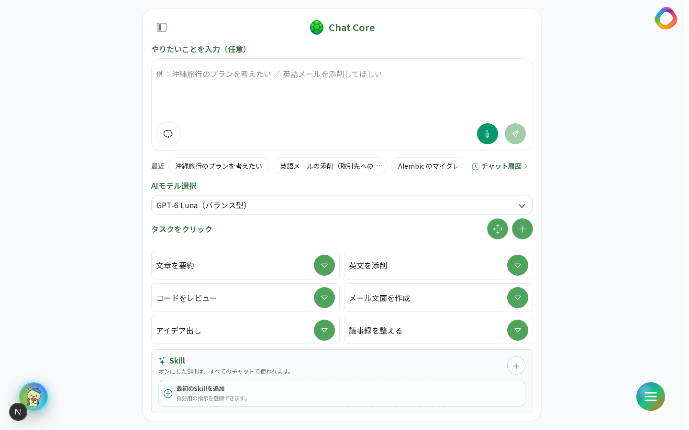
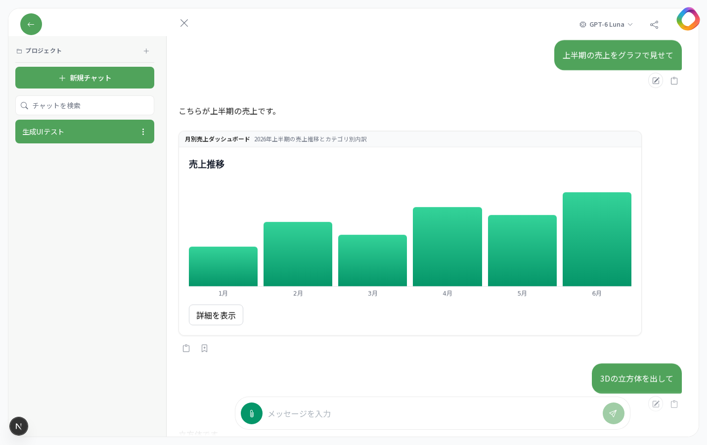
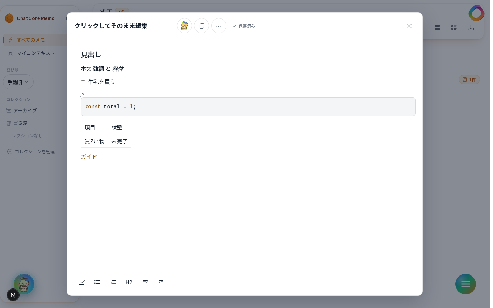
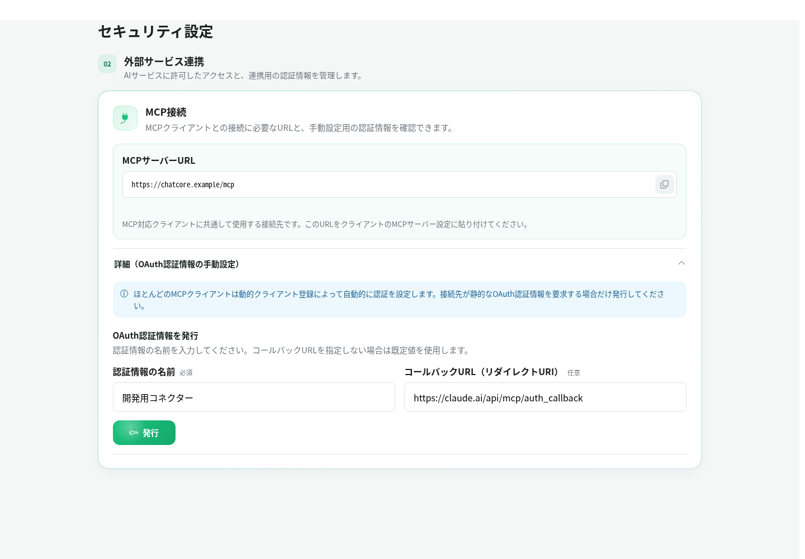
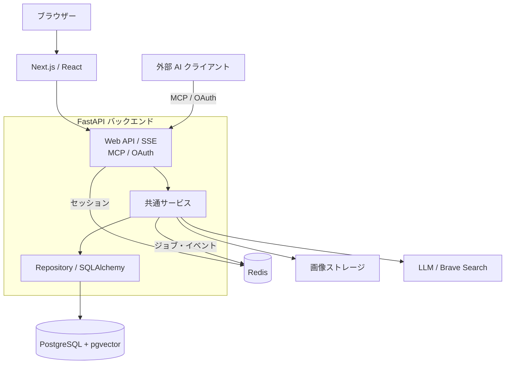
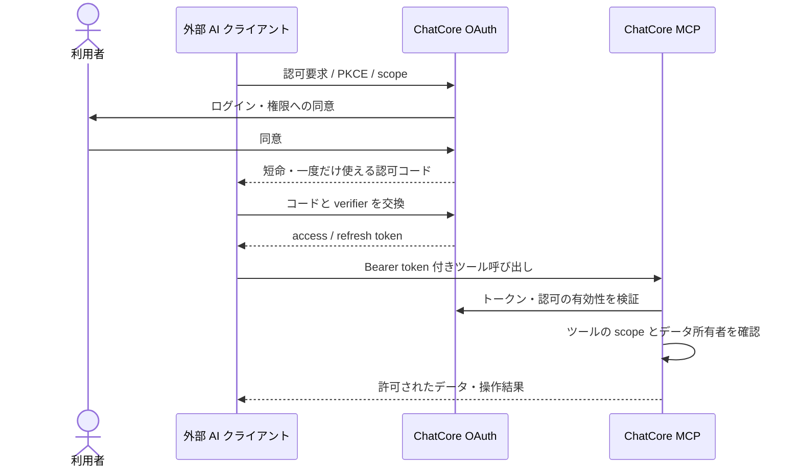

# ChatCore-AI

**繰り返し使う指示と個人の知識を、AI との会話につなぐ。**

[ライブデモ](https://chatcore-ai.com/) · [デモ動画](https://youtu.be/tdPZJdZfeQ0) · [English](#english) · [内部設計](ARCHITECTURE.md)


## このアプリでできること

毎回同じ指示を書き直す手間を減らすため、よく使う依頼を **タスク**、再利用する指示を **Skill** として保存できる AI チャットアプリを制作しました。会話だけでなく、メモ・個人のコンテキスト・公開プロンプトも扱えます。MCP を通じて外部の AI クライアントからも同じデータにアクセスできます。

| 機能 | 利用体験 |
| --- | --- |
| タスク・Skill | 自分用の指示を登録し、少ない入力で会話を開始。公開プロンプトからも取り込める |
| AI チャット | 複数モデルを選択し、SSE で応答を逐次表示。履歴・一時チャット・共有・文書添付・画像入力に対応 |
| Web 検索・生成 UI | 出典を付けた回答や、会話内で操作できる 2D／3D の図・グラフを表示 |
| メモ・マイコンテキスト | メモを編集・整理・共有し、好みやプロジェクト情報などの個人の事実を保存・検索 |
| MCP 連携 | 外部 AI から公開プロンプトを扱い、本人のメモ・コンテキストを読み書き。クライアントを変えても知識を再利用 |

会話モデルは **GPT-OSS 120B / GPT-6 Luna / Qwen 3.8 27B / Claude Haiku 5.5**。画像を読めるモデルは GPT-6 Luna に限定し、画像は持ち主だけが取得できる保存先で管理します。

## 画面

タスクと Skill から会話を始めるホーム画面です。



<details>
<summary>生成 UI・メモ編集・MCP 設定の画面を見る</summary>

### 会話の中で動く生成 UI



### メモの表示を保ったまま編集



### 外部 AI との接続を管理



</details>

## アーキテクチャ

Web UI と外部 AI クライアントは別の入口を使い、共通のサービス・Repository を通じてデータを扱います。永続データは PostgreSQL、セッションや生成ジョブの協調は Redis、画像は永続ボリュームへ分けています。



- **画面・HTTP・業務処理・DB アクセスを分離**し、Web と MCP で共通のデータ操作を再利用します。
- **生成処理と SSE 接続を分離**し、専用スレッドプールで応答を生成します。停止時も生成済みの本文を保存し、Redis で複数ワーカー間のイベント配信・停止要求を協調します。
- **LLM の差は Adapter に集約**し、会話モデルごとに別の検索・回答フローを作らず、共通の判断ループを使います。

実装: [アプリ構成](app.py) · [チャット生成](services/chat_generation.py) · [生成の協調](services/chat_generation_coordinator.py) · [LLM Adapter](services/llm.py)

## MCP によるデータの再利用

例えば、ある AI クライアントで保存した「回答は日本語で簡潔に」「現在進めているプロジェクト」といった情報を、別の MCP 対応クライアントから取得して会話の参考にできます。クライアントごとに本人の ChatCore アカウントへ接続を認可し、ユーザー ID に紐づいた同じデータを参照します。

| データ | MCP からできること | 公開範囲 |
| --- | --- | --- |
| Prompt・Skill | 公開コンテンツの検索・取得、Prompt／画像 Prompt／Skill の新規投稿 | 投稿は公開 |
| メモ | 一覧・検索・取得・作成・更新・追記 | 認証した本人のメモ。共有中のメモの変更には追加の許可が必要 |
| マイコンテキスト | 種類別の概要取得、キーワード／意味検索、事実の保存・更新・無効化 | 認証した本人の事実 |

マイコンテキストは、**好み・プロフィール・プロジェクト・意思決定・参考情報**の種類を持つ小さな事実として保存します。保存元のクライアント・版番号・本人の確認状態も管理します。MCP で保存した事実は本人が確認済みとは扱わず、チャットで参照した際の自動書き込みを抑止する判断にも使います。

外部クライアントへは必要なデータをツールの結果として返します。クライアントの会話履歴全体を ChatCore のチャット履歴へ自動同期する方式ではありません。

実装: [MCP サーバー](services/mcp_server.py) · [メモツール](services/mcp_tools/memos.py) · [コンテキストツール](services/mcp_tools/context_vault.py) · [事実の保存・検索](services/context_vault_service.py)

## OAuth とアクセス制御

**アプリへのログイン**はメールの6桁コード・Google OAuth・Passkey に対応します。**外部 AI へのデータアクセス許可**は、別の MCP OAuth フローで管理します。



- **権限を6つの scope に分割**: `prompts`・`memos`・`context` それぞれの `read`／`write`。トークンのユーザー ID とツールごとの scope を確認します。
- **認可コードは一度だけ消費**し、PKCE・redirect URI・MCP の resource を確認します。動的クライアント登録と手動の認証情報発行に対応します。
- **access／refresh token は digest で保存**し、クライアント secret は暗号化します。refresh token のローテーションと短い再送猶予を設け、連携は設定画面から失効できます。
- **ブラウザーのセッション本体は Redis**へ保存し、Cookie には署名付き参照 ID だけを持たせます。Web API の状態変更は CSRF トークンで保護します。

実装: [OAuth](services/mcp_oauth.py) · [認証情報の永続化](services/repositories/mcp_oauth_repository.py) · [ツールの権限確認](services/mcp_tools/common.py) · [セッション](services/session_middleware.py)

## 重複・競合を防ぐ設計

再送、複数タブ、複数 AI クライアントからの操作を、処理ごとの境界で扱います。

| 場面 | 実装した仕組み | 結果 |
| --- | --- | --- |
| MCP のコンテキスト保存を再送 | 同じユーザー・クライアントの `idempotency_key` と保存内容をハッシュ化し、DB の一意制約で保護 | 同じキー・内容は既存の事実を返し、同じキーで内容が違えば競合として拒否 |
| メモ・コンテキストを同時編集 | MCP 更新時に `expected_revision` を確認し、更新条件にも版番号を含める | 古い読み取り結果による上書きを防ぐ |
| チャットの承認カードを二重送信 | 承認行をトランザクション内でロックし、確定状態を再確認 | 同じカードの書き込みを二重実行しない |
| 同じ部屋のチャット生成を同時開始 | Redis の生成ロックを取得し、実行中に期限を更新 | 複数ワーカーからの生成の重なりを抑える |

コンテキスト保存の再送防止は、クライアントが同じ `idempotency_key` を送る場合の仕組みです。公開投稿やメモ作成を含む、すべての MCP 書き込みを自動的に重複排除するものではありません。

実装: [コンテキストの一意性](services/repositories/context_fact_repository.py) · [メモの版管理](services/repositories/memo_repository.py) · [承認の確定](services/chat_tool_approval_service.py) · [生成ロック](services/chat_generation_coordinator.py)

## AI の出力をアプリで扱う工夫

**生成 UI は検証してから隔離 iframe で実行**します。HTML・CSS・JavaScript の契約を検証し、検索画像もサーバーが許可した署名付き中継 URL を使います。

**チャットからの書き込みは承認カードを経由**します。対応する操作に「常に承認」を設定していても、外部本文や本人未確認のコンテキストを読んだターンでは自動実行を抑止します。公開 Prompt の新規投稿は毎回の承認が必要です。

**API の利用量と料金を記録**し、ユーザー／ゲスト単位の上限と全体の月予算を処理開始前に確認します。実行中のターンが料金上限を超えて終わる可能性は残るため、全体予算には余裕を設けています。

実装: [生成 UI](services/generative_ui.py) · [書き込みツール](services/chat_workspace_tools/runner.py) · [利用上限](services/usage_limits.py)

## 技術選定

| 技術 | 選んだ理由 | トレードオフ・運用上の条件 |
| --- | --- | --- |
| FastAPI / Pydantic | 非同期 API と型付き入力検証をまとめ、API 契約を明示できる | 長時間の生成や blocking I/O は別の実行経路へ分離する |
| Next.js / React / TypeScript | チャット・メモ・設定の画面をコンポーネントと hook に分け、状態と描画を整理できる | クライアント状態と API 契約の同期が必要 |
| PostgreSQL 18 / pgvector | ユーザー・認可・版管理をトランザクションで扱い、意味検索も同じ DB に置ける | 検索用の埋め込み生成と、Alembic によるスキーマ管理が必要 |
| SQLAlchemy 2 / psycopg 3 | AsyncSession を Repository に渡し、ユースケース単位で transaction を管理できる | ワーカー数とプール上限を DB 接続容量に合わせる |
| Redis | セッション・生成ロック・イベント配信を複数ワーカーで共有できる | 認証セッションの保存に必須。保存障害時は Cookie を消去する |
| MCP / OAuth | 外部 AI へツールを公開し、データごとの読み書き権限を利用者が認可できる | クライアント差、トークン更新・失効、再送・競合を扱う必要がある |
| Pydantic → Zod | バックエンドが所有する API モデルからフロントエンドの検証スキーマを生成できる | 契約外の既存応答には正規化層を残し、モデル変更時に再生成する |

LLM は Groq・Anthropic・OpenAI の3プロバイダを Adapter で統合しています。主な技術判断は [ADR 一覧](docs/decisions/README.md) に記録しています。

## 品質と運用

GitHub Actions で依存の固定・脆弱性監査、Ruff／mypy／Vulture、4 shard の単体テスト、PostgreSQL を使う統合テスト、フロントエンドの lint・型検査・テスト、Docker ビルドを実行します。ユニット＋統合テストの合算カバレッジには **70% のゲート**を設けています。

本番は **Blue/Green デプロイ**です。`main` で CI を手動実行し、その実行の全チェック通過後にデプロイします。旧色を退役させる前はトラフィックを戻せます。退役後の cleanup 失敗では新色を稼働させたまま調査します。`/healthz` は生存確認、`/readyz` は DB と主要テーブルの確認に加え、Redis・埋め込みの劣化を報告します。

実装: [CI](.github/workflows/tests.yml) · [Blue/Green デプロイ](deploy/blue_green_deploy.sh) · [ヘルスチェック](services/health.py)

<details>
<summary>開発向けの補足</summary>

Docker Compose v2 で FastAPI・Next.js・PostgreSQL・Redis を起動できます。

```sh
git clone https://github.com/kota-kawa/ChatCore-AI.git
cd ChatCore-AI
cp .env.example .env
# 以下の設定を済ませてから起動
docker compose up --build app frontend db redis
```

ローカル HTTP 開発では `FASTAPI_ENV=development`、`FASTAPI_SESSION_SAMESITE=lax`、`FRONTEND_URL=http://localhost:3000` を設定し、署名鍵・Redis／DB 接続情報・使用する外部サービスのキーを自分の値へ置き換えます。テンプレートの本番設定では起動時 migration を省略するため、そのまま使わないでください。

フロントエンドは `http://localhost:3000`、API は `http://localhost:5004`。開発コンテナは起動時に Alembic migration を適用します。全環境変数は [`.env.example`](.env.example)、構成と責務は [ARCHITECTURE.md](ARCHITECTURE.md)、開発コマンドは [開発規約](docs/knowledge/development_conventions.md) を参照してください。

</details>

<a id="english"></a>
<details>
<summary>English — product and engineering overview</summary>

## ChatCore-AI

**Reusable instructions and personal knowledge, connected to AI conversations.**

[Live demo](https://chatcore-ai.com/) · [Demo video](https://youtu.be/tdPZJdZfeQ0)

ChatCore-AI grew out of the friction of retyping the same prompts. Tasks provide reusable starting points, Skills supply reusable instructions, and memos and personal context preserve knowledge beyond a single conversation. An OAuth-protected remote MCP server exposes that data to compatible external AI clients.

### Product experience

| Area | Capabilities |
| --- | --- |
| Tasks and Skills | Save instructions and import useful public prompts |
| Chat | Streaming replies, history, temporary conversations, sharing, document attachments, and private image input |
| Search and generated UI | Source citations and interactive 2D/3D visuals inside the conversation |
| Personal knowledge | Editable memos, collections, sharing/export, and typed personal context facts |
| External AI integration | Read and write authorized data through MCP, and reuse it across clients |

Selectable chat models are GPT-OSS 120B, GPT-6 Luna, Qwen 3.8 27B, and Claude Haiku 5.5. Image input is limited to GPT-6 Luna. The screenshots and architecture diagram above show the web experience and the shared backend.

### Architecture

Next.js/React serves the web UI. FastAPI exposes browser APIs, SSE, remote MCP, and OAuth. Services and repositories share PostgreSQL data access; pgvector supports semantic search. Redis holds sessions and coordinates generation locks, events, and quotas. Uploaded images live in persistent volumes with separate public/private access boundaries.

Generation runs in a dedicated thread pool, while SSE delivers events and supports cancellation with partial-response preservation. Groq, Anthropic, and OpenAI differences stay in the LLM adapter; chat uses one shared decision loop across providers.

### MCP data and OAuth

| Data | Tools | Visibility |
| --- | --- | --- |
| Prompts and Skills | Search/fetch public content; publish new text/image prompts and Skills | Public posts |
| Memos | List/search/read/create/update/append | The authenticated owner's memos; modifying shared content requires additional permission |
| Personal context | Get a typed digest, keyword/semantic search, save/update/deprecate facts | The authenticated owner's facts |

Context facts record preferences, profile details, projects, decisions, and references, along with provenance, revision, and owner-confirmation state. A second authorized client can retrieve the same account's facts. This is tool-based data access, rather than automatic synchronization of entire external chat histories. MCP-created facts begin unconfirmed and can suppress automatic chat writes when retrieved.

App sign-in supports email codes, Google OAuth, and Passkeys. External client authorization uses a separate Authorization Code + PKCE flow with one-time codes, redirect/resource validation, and six scopes: read/write for prompts, memos, and context. Each tool checks its scope and derives the owner from the token. Access/refresh tokens are stored as digests; client secrets are encrypted. Refresh rotation includes a short retry grace window, and users can revoke connections.

### Duplicate and conflict prevention

- **Context saves:** when an MCP client reuses an `idempotency_key`, a user/client-scoped key hash, a normalized payload hash, and a database uniqueness constraint return the existing fact for identical retries and reject changed payloads.
- **MCP updates:** `expected_revision` prevents stale memo/context edits from overwriting newer data.
- **Chat approvals:** transaction locks and settled-state checks prevent executing the same card twice.
- **Generation:** renewed Redis locks limit overlapping jobs for the same room.

Idempotency is specific to keyed context saves; public publishing and memo creation do not have universal retry deduplication.

### Technology choices and reliability

| Choice | Reason and tradeoff |
| --- | --- |
| FastAPI / Pydantic | Async APIs and explicit typed contracts; long-running generation and blocking work need separate execution paths |
| Next.js / React / TypeScript | Component/hook composition for chat, memos, and settings; client state must stay aligned with API contracts |
| PostgreSQL / pgvector | Transactions, ownership, revisions, and semantic search in one datastore; embeddings and migrations need lifecycle management |
| SQLAlchemy / psycopg | Async repository access and use-case transactions; pool capacity must account for every worker |
| Redis | Shared sessions and generation coordination; authenticated session persistence depends on its availability |
| MCP / OAuth | Interoperable tools and user-authorized data scopes; client differences, token lifecycle, retries, and conflicts remain explicit concerns |
| Pydantic → Zod | Generate frontend validators from backend-owned models; regenerate on changes and normalize legacy responses separately |

Generated UI passes validation and runs in an isolated iframe. Chat writes use approval cards; eligible automatic approvals are suppressed after external or unconfirmed context is read. Public Prompt creation always requires approval. API cost accounting checks personal daily/weekly limits and a shared monthly budget before new AI work starts; in-flight turns can exceed a limit.

CI covers locked dependencies and vulnerabilities, backend static checks, four unit-test shards, PostgreSQL integration tests, a combined 70% coverage gate, frontend checks, and Docker builds. Production deployment is manual on `main`, after all checks pass, using Blue/Green traffic switching. Rollback is available before retiring the old color; later cleanup failures leave the new color serving. Health endpoints report liveness, database/schema readiness, and optional Redis/embedding degradation.

See [ARCHITECTURE.md](ARCHITECTURE.md) for internal boundaries, [ADRs](docs/decisions/README.md) for design decisions, and [development conventions](docs/knowledge/development_conventions.md) for commands. For local HTTP development with Compose v2, copy [`.env.example`](.env.example), set `FASTAPI_ENV=development`, `FASTAPI_SESSION_SAMESITE=lax`, and `FRONTEND_URL=http://localhost:3000`, supply your credentials/provider keys, then run `docker compose up --build app frontend db redis`. The template defaults to production and skips startup migrations.

</details>

## License

Copyright (c) 2026 Kota Kawagoe. Licensed under [Apache License 2.0](LICENSE).
