# Data model overview

PostgreSQL の構造は `alembic/versions/` の適用後状態が正本です。ここでは機能間の関係を示し、全列・全インデックスを複製しません。SQLAlchemyモデルの登録先は`services.models.Base.metadata`で、Alembicの`target_metadata`と共有します。DBアクセスは`AsyncSession`をRepositoryへ渡し、通常のCRUDはORM、複雑検索・JSONB・pgvector・PostgreSQL固有処理はSQLAlchemy Coreまたは`text()`で実装します。

## エンティティの関係

```mermaid
erDiagram
    users ||--o{ user_passkeys : owns
    users ||--o{ user_auth_providers : uses
    users ||--o| demo_access_codes : "demo account of"
    users ||--o{ chat_rooms : owns
    chat_rooms ||--o{ chat_history : contains
    chat_rooms ||--o| shared_chat_rooms : shares
    users ||--o{ chat_tool_approvals : proposes
    chat_history ||--o{ chat_tool_approvals : carries
    users ||--o{ chat_tool_auto_approvals : grants
    users ||--o{ projects : owns
    projects ||--o{ project_files : contains
    projects ||--o{ chat_rooms : groups
    users ||--o{ task_with_examples : owns
    task_with_examples ||--o{ task_versions : versions
    users ||--o{ user_skills : owns
    users ||--o{ prompts : authors
    prompts ||--o{ prompt_versions : versions
    prompts ||--o{ prompt_resources : contains
    prompts ||--o| prompt_view_counts : counts
    prompts ||--o| prompt_impression_counts : shows
    prompts ||--o{ prompt_comments : receives
    prompts ||--o{ prompt_likes : receives
    users ||--o{ memo_entries : writes
    memo_collections ||--o{ memo_entries : groups
    memo_entries ||--o| shared_memo_entries : shares
    users ||--o{ context_facts : owns
    context_facts ||--o{ context_fact_candidates : promotes
    context_facts ||--o| context_facts : "superseded by"
    users ||--o{ context_fact_sources : owns
    context_facts ||--o{ context_fact_sources : cites
    chat_rooms ||--o{ context_fact_sources : "mentioned in"
    users ||--o{ mcp_oauth_grants : authorizes
    users ||--o{ mcp_oauth_user_clients : owns
    mcp_oauth_clients ||--o{ mcp_oauth_grants : receives
    mcp_oauth_clients ||--o| mcp_oauth_user_clients : customizes
    mcp_oauth_grants ||--o{ mcp_oauth_tokens : issues
```

## 機能別の主要テーブル

| 領域 | 主要テーブル | 関係・注意点 |
| --- | --- | --- |
| Identity | `users`, `user_passkeys`, `user_auth_providers` | ほとんどのユーザー所有データは `users.id` に紐づく。認証プロバイダー情報の正本は`user_auth_providers`のみで、`services/repositories/auth_identity_repository.py`がメール・Google・Passkey向けの永続化契約を所有する。`users` 行そのもの（プロフィール、サインイン用メール、`preferred_locale`）とアカウント削除は `services/repositories/user_repository.py` が所有する。 |
| Demo access | `demo_access_codes` | 応募先ごとに配るデモ用アクセスコード。コード本体は保存せず SHA-256 の digest（一意）だけを持つ。初回利用で作ったデモ用ユーザーを `user_id`（一意、ON DELETE SET NULL）で結び、`first_used_at` から 30 日後を `expires_at` に入れる。`revoked_at` は管理者による停止。期限切れと停止ではユーザーを削除して行は残すため、`user_id` が NULL の行は終了済み（未使用は `first_used_at` も NULL）。所有は `services/repositories/demo_access_repository.py`、判断は `services/demo_access.py`（[ADR 0021](../decisions/0021-demo-access-codes.md)）。 |
| Chat | `chat_rooms`, `chat_history`, `shared_chat_rooms`, `chat_room_summaries`, `memory_facts`, `user_skills`, `chat_tool_approvals`, `chat_tool_auto_approvals` | 永続化境界は機能別に分かれ、ルーム・履歴・分岐・共有・ルーム内メモリを `services/repositories/chat_repository.py` が、`user_skills` と既定スキルの ON/OFF（`users.generative_ui_skill_enabled`、`users.memo_tools_skill_enabled`、`users.prompt_tools_skill_enabled`）を `services/repositories/user_skill_repository.py` が、承認カードと「常に承認」の付与を `services/repositories/chat_tool_approval_repository.py` が所有する。部屋削除は履歴・要約・ルーム内メモリ・承認カードへ cascade する。`chat_rooms.mode` は `normal`／`temporary`。`chat_rooms.last_activity_at` はメッセージ保存時に更新され、履歴一覧の新着順とカーソル境界の正本になる。`chat_rooms.pinned_at` はサイドバーのピン留めで、NULL がピン留めなしを表す。ピン留めした部屋はページング対象の履歴一覧から外れ、最初のページに `pinned_rooms` として全件（件数上限なし）をピン留めした新しい順で返す。付け外しでは `last_activity_at` を更新しない。`shared_chat_rooms.revoked_at`／`expires_at` は共有リンクのライフサイクルで、どちらも NULL の行だけが公開読み取りの対象になる。`user_skills` はユーザーがトップページで登録する再利用指示で、有効行だけがチャット生成時の追加システム文脈になる。生成UIとメモは、コード定義の削除・編集不可なデフォルトSkillであり、ユーザーごとのON/OFFだけを `users` の列に保存するため、`user_skills` の件数上限には含めない。共有 Skill から追加した行は `source_prompt_id` で出典と追加済み状態を追跡し、共有元が削除された場合も Skill 本体は残して参照だけを NULL にする。`chat_tool_approvals` は書き込みツール（メモの作成・追記・書き換え、公開 Prompt の新規投稿、自分用 Prompt・個人 Skill の作成・編集）の承認カード1件を1行に持ち、`assistant_message_id` は回答の保存まで NULL、`status` は `pending`／`succeeded`／`failed`／`denied`／`expired`／`superseded`／`cancelled`。`chat_tool_auto_approvals` は利用者とツール名の組で一意な「常に承認」の付与で、取り消しは行の削除。両テーブルの値の集合は `services/response_models.py` の Literal を正本にし、DB の CHECK 制約はそこから組み立てる（[ADR 0013](../decisions/0013-chat-writes-through-stored-approvals.md)）。 |
| Projects | `projects`, `project_files` | プロジェクトはユーザー所有。チャット部屋から project を参照する。`services/repositories/project_repository.py` が `projects` と `chat_rooms.project_id` の所属を所有し、部屋の所有者確認は `services/repositories/chat_room_access.py` を共有する。 |
| Tasks | `task_with_examples`, `task_versions` | `services/repositories/task_repository.py` が所有する。system task とユーザー task を同じ主テーブルで扱い、論理削除・revision・source prompt を追加情報として持つ。version 行は旧列に加えて、現在の task 全体を `snapshot` JSONB に保存する。 |
| Prompt sharing | `prompts`, `guest_prompt_submissions`, `prompt_versions`, `prompt_view_counts`, `prompt_impression_counts`, `prompt_list_entries`, `prompt_likes`, `prompt_comments`, `prompt_comment_reports`, `prompt_resources` | 公開プロンプト、ゲスト投稿のCookie/IPハッシュと引継ぎ状態、バージョン、ビュー数、いいね、コメント、Skill resources を分離する。未引継ぎゲストの `prompts.user_id` と `prompt_versions.user_id` は NULL を許容し、version 行は `snapshot` JSONB に現在の prompt 全体を保存する。ビュー数とカードの表示回数は編集日時・履歴を更新しない専用カウンターで保持し（2 つを並べるとクリック率になる）、`prompts.featured_at` は運営が一覧の先頭に固定した投稿の日時（NULL は通常の投稿）で、画像本体は DB ではなく attachment storage 境界へ委譲する。`prompts.embedding_vector` は意味検索・関連投稿用の補助情報で、`embedding_status` が `pending`／`ready` の再生成状態を表す。 |
| Memo | `memo_collections`, `memo_entries`, `shared_memo_entries` | メモ本体、コレクション、期限・撤回可能な共有トークンを分離する。embedding はメモ検索用の補助情報で、`embedding_status` が `pending`／`ready` の再生成状態を表す。`memo_entries.deleted_at` はゴミ箱（NULL が通常のメモ）で、値があるメモはゴミ箱の一覧・復元・完全削除以外のどの経路（一覧・詳細・更新・検索・コレクション件数・エクスポート・共有・MCP・チャットのメモツール・embedding backfill）にも現れない。ゴミ箱へ移す時点で共有リンクは解除（`shared_memo_entries.revoked_at` を設定）され、復元しても自動では再開しない（共有設定からもう一度有効にする）。保持日数は `services/repositories/memo_constants.py` の `MEMO_TRASH_RETENTION_DAYS`（30日）で、超えた行は `app.py` の定期クリーンアップが物理削除し、共有行は ON DELETE CASCADE で一緒に消える。 |
| Context vault | `context_facts`, `context_fact_candidates`, `context_fact_sources` | active/deprecated の事実を持つ。チャットから抽出した内容は、本人未確認（`last_confirmed_at` が NULL）の事実として直接 `context_facts` へ入る。有効件数が上限のときは、`source_kind` が `chat`、`last_confirmed_at` が NULL で、`revision` が初期値の 1 の事実（自動保存のまま一度も更新されていない、本人が手を入れていないもの。復元・重要度の変更・無効化は `revision` を進める）のうち最後に話題に出た時刻が最も古いもの（出典の `observed_at` の最大値、出典が無ければ `created_at`。同じなら重要度が低いもの、`id` が小さいもの）を同じトランザクションで無効化して入れ替え、対象が無ければ保存しない。`deprecated_reason` は無効化の理由で、`user`（本人・MCP）、`capacity`（上限での入れ替え）、`superseded`（新しい事実による置き換え）を書き、`merged` は後続の変更が使う。NULL は有効な事実と、列の追加前に無効化した事実（`user` と同じ扱い）。`superseded_by_fact_id`（`context_facts.id` への自己参照、ON DELETE SET NULL、NULL でない行だけの部分索引）は置き換えた新しい事実を指し、`superseded` の事実だけが持つ（有効へ戻すと理由と一緒に NULL に戻る）。チャットから抽出した内容が既存の有効な事実と食い違うときは、保存前の照合（意味の近い事実を埋め込みで引き、あるときだけ LLM が追加・更新・言い換えを判定。[ADR 0025](../decisions/0025-always-on-memory-with-provenance.md)）が更新と判定すれば、同じトランザクションで対象を無効化（`superseded`、`revision` を進める）し、新しい事実を未確認として入れ、対象に置き換え先を記録する。有効件数は変わらないので上限での入れ替えは起こさず、対象が判定の時点の `revision` と違えば置き換えず追加として保存する。言い換えは出典だけを足し、本人が無効化した事実の言い換えは何も保存しない。照合の対象は、BM25 の重複判定で重複しなかった候補と、BM25 の最良一致が有効な事実だった候補（語の重なりで重複とみなされる食い違いを、再言及として吸収しないため）。後者は一致した事実を埋め込みの有無に関係なく近い事実に入れ、判定が無ければ従来どおりその事実への再言及にする。照合で作った埋め込みは新しい事実にそのまま保存する（`embedding_status` は `ready`）。`superseded_by_fact_id` は、本人・MCP が理由 `user` で無効化したとき（置き換えで無効化した事実を改めて無効化したときを含む）と、有効へ戻したときに NULL へ戻る。重複判定と照合の比較対象は、有効な事実と本人が無効化した事実（理由 `user` か NULL）で、`superseded`・`capacity` で無効化した事実は含めない。BM25 の最良一致は 1 件なので、有効な事実に一致した候補が新しい事実になる結果（追加・置き換え）のときは、保存の段で本人が無効化した事実と却下済みの候補だけを対象にした BM25 を、読み取り済みの比較対象に対してもう一度かけ（追加の読み取りは無い）、重複していれば新しい事実を作らず最良一致の有効な事実への再言及にする。`context_fact_candidates` は承認待ちの一覧としては使わず、本人が却下した候補（`rejected`）を重複判定で読むためだけに残す（過去の承認待ちの移行とテーブルの扱いは [ADR 0023](../decisions/0023-auto-save-extracted-memory.md)）。`users.context_auto_extract_enabled`（初期値 TRUE）が抽出の設定。`context_facts.embedding_status` で vector の生成待ちを監視する。`context_facts.confidence`（抽出時の確信度）と `last_confirmed_at`（本人が最後に確かめた時刻、NULL は未確認）は `updated_at` とは別に持つ（[ADR 0016](../decisions/0016-context-fact-confirmation.md)、[ADR 0023](../decisions/0023-auto-save-extracted-memory.md)）。`context_fact_sources` は事実が言及された記録で、1 行が 1 回の言及（本人発話と照合した引用 `evidence`（NFKC・空白・大文字小文字を正規化して照合するため、元の発話と 1 文字単位で同じとは限らない）、ルーム、発話 `user_message_id`、`observed_at`）。チャットからの直接保存で 1 件入り、同じ内容が有効な事実と重複したときは事実の行を更新せず出典だけが足される。1 つの事実に新しい順で最大 20 件を保ち、同じ発話から同じ事実へは 1 件（`user_message_id` が非 NULL の行で一意）。言及回数・最終言及日は列に持たずこの行から導く。事実・ルーム・アカウントの削除で消え、発話だけが消えたときは行を残して `user_message_id` を NULL にする。事実のタイトル・内容・種類が実際に変わる更新では、引用が新しい文面を裏づけないため同じトランザクションで削除する（MCP による書き換えは `source_kind` も `mcp` にする）。過去に保存した事実には出典が無い。 |
| MCP OAuth | `mcp_oauth_clients`, `mcp_oauth_user_clients`, `mcp_oauth_grants`, `mcp_oauth_authorization_codes`, `mcp_oauth_tokens` | client、ユーザー別 client 表示、grant、短命 authorization code、access/refresh token を分離する。token の保存値は digest 化される。 |

共有リンクの公開パス、token生成設定、衝突判定、期限・撤回状態のシリアライズは共有サービスで再利用します。ただし `shared_chat_rooms` と `shared_memo_entries` の保存境界・ライフサイクルは統合せず、公開プロンプトは引き続き `prompts.id` と soft-delete を正本にします。

`prompt_list_entries_legacy` と `prompt_list_entries_v2` は migration の変換過程で現れる名前であり、現行機能の所有境界を判断する際は現在の `prompt_list_entries` と migration head を確認します。

## 永続化されない状態

- セッション本体は Redis の `session:<id>`。Cookie は署名済み参照 ID のみです。
- Google OAuth の短命トランザクションは Redis の `google_oauth_transaction:<state>` に保存し、stateを専用HttpOnly Cookieと照合してコールバックで一度だけ消費します。OAuth状態は一般セッションへ保存しません。
- メール認証の短命トランザクションは Redis の `email_auth_transaction:<id>` に保存し、コードdigest、ユーザー、flow、試行回数を専用HttpOnly Cookieと紐づけます。ログイン・新規登録の認証コードは一般セッションへ保存せず、Redisの `WATCH`／`MULTI`／`EXEC` による楽観的排他で検証・試行回数更新・消費を行います。
- キャッシュ、日次・月次クォータ、single-flight lock、チャット生成のイベント協調は Redis を使います。
- プロンプト共有画像の表示用・カード用 WebP は `PROMPT_SHARE_UPLOAD_DIR` の永続 Docker volume に保存されます。DB は添付 descriptor と参照関係の source of truth です。
- アバター画像は `AVATAR_UPLOAD_DIR` の永続 Docker volume に保存し、`/api/user/avatars/<filename>` としてアプリが配信します。`users.avatar_url` が source of truth で、旧 `/static/uploads/<filename>` は読み出し時に `services/avatar_storage.py` の `normalize_avatar_url` が現行URLへ読み替えます。既定アイコン `/static/user-icon.png` は frontend の静的アセットです。
- エフェメラルチャットの削除、保持期間を過ぎたゴミ箱のメモの完全削除、期限を過ぎたデモ用アカウントの削除、添付ファイルとアバターの orphan cleanup、起動時 seed は `app.py` の lifespan／バックグラウンド処理から実行されます。

## スキーマ変更を追う場所

1. `alembic/versions/` で対象テーブルの作成・変更 revision を検索する。
2. `services/repositories/` または機能内 repository と、所有者確認を行う route/service を確認する。
3. API の形状も変わる場合は Pydantic model と生成 Zod schema を確認する。
4. `alembic current` と `alembic heads` で適用状態を確認し、既存 revision は編集しない。
